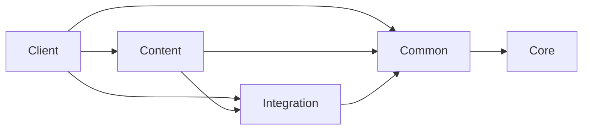

# Целевая архитектура / Target architecture

Этот документ задаёт проверяемое направление постепенной миграции. Он не описывает
текущий `net.mcreator.ssc` как уже завершённую архитектуру и не разрешает массовое
переименование пакетов.

This document defines an enforceable direction for incremental migration. It does
not present the current `net.mcreator.ssc` tree as the finished architecture and it
does not authorize a bulk package rename.

<!-- architecture-contract:ru -->

## Русский контракт

### Назначение, цели и ограничения

Новый поддерживаемый код постепенно размещается в `net.ssc14`. Существующий
`net.mcreator.ssc` остаётся legacy-адаптером и источником миграции: зависимости
временно направлены из legacy-кода в целевой код, но целевые слои не импортируют
legacy namespace.

Цели:

- отделить чистые правила от Minecraft и NeoForge;
- сделать серверные сценарии единственными владельцами игрового состояния;
- изолировать client-only API и уменьшать зафиксированный долг;
- переносить по одной подсистеме на PR с сохранением публичных контрактов;
- проверять границы статически, а поведение — unit-, domain- и GameTest-тестами.

Не являются целями этого этапа массовый перенос `net.mcreator.ssc`, изменение mod
ID `ssc_14`, registry ID, ресурсов, SavedData/NBT, payload, геймплея, зависимостей
или создание абстракций «на будущее». Пустые пакеты и классы запрещены: слой
появляется на диске только вместе с реальным кодом и тестом.

### Пять слоёв и ответственности

```text
net.ssc14.core.<subsystem>          чистые значения, алгоритмы и политики Java
net.ssc14.common.<subsystem>        серверные use case и platform-neutral порты
net.ssc14.integration.neoforge.*    события, сеть, persistence и NeoForge-адаптеры
net.ssc14.content.*                 блоки, предметы, сущности, меню и регистрации
net.ssc14.client.*                  renderer, screen, input и client projection
```

`net.ssc14.core` зависит только от JDK и собственного Core. `net.ssc14.common`
содержит серверные сценарии; server-safe Minecraft-типы допустимы только когда
немедленная замена value object не оправдана. `net.ssc14.integration` владеет
адаптерами платформы и будущим composition root. `net.ssc14.content` связывает
игровой контент с use case. `net.ssc14.client` отображает подтверждённое сервером
состояние и не принимает бизнес-решения.

Исполняемая матрица разрешённых целевых зависимостей:

```text
core -> core
common -> core, common
integration -> core, common, integration
content -> core, common, integration, content
client -> core, common, integration, content, client
```



Стрелка означает «может зависеть от». Обратные стрелки, циклы между слоями,
неизвестный прямой пакет `net.ssc14.*` и импорт `net.mcreator.ssc` из целевого
кода запрещены. Зависимости внутри одного слоя допустимы.

### Текущее дерево и назначения миграции

Текущие `atmosphere/*`, `energy/*` и `chemistry/*` содержат смесь домена,
Minecraft-адаптеров и orchestration. При переносе чистые значения и алгоритмы
идут в Core, серверные операции — в Common, SavedData/payload/event glue — в
Integration, блоки/предметы/меню — в Content, экраны/render/input — в Client.
Это карта назначения, а не обещание перенести все пакеты одним изменением.

Первый реальный пример — перенос `ProportionalAllocation` в
`net.ssc14.core.math` с делегирующим legacy-фасадом. Composition root должен
находиться под `net.ssc14.integration.neoforge`, но создаётся только тогда,
когда есть реальная сборка зависимостей; placeholder и marker-классы запрещены.

Реестр типов частиц — первая миграция в Content. Новым реестром владеет
`net.ssc14.content.particle.Ssc14ParticleTypes`, а сгенерированные потребители
временно работают через deprecated-фасад `Ssc14ModParticleTypes`. Registry ID
не изменены и защищены манифестом совместимости Stage 4.

### Серверный авторитет и UI

Сервер является источником истины для инвентарей, атмосферы, энергии, химии,
доступа и всех изменяемых игровых состояний. Common use case проверяет
разрешения и инварианты; Integration переводит входы NeoForge в команды;
Client показывает server snapshot и отправляет намерение пользователя. UI —
проекция состояния, а не альтернативная реализация доменной логики.

### Граница клиента и сокращаемый долг

Client-only семейства определены точными префиксами:

- `net.minecraft.client`;
- `net.neoforged.neoforge.client`;
- `com.mojang.blaze3d`;
- `org.lwjgl`.

Они разрешены в `net.ssc14.client` и существующем
`net.mcreator.ssc.client`. В остальных legacy-файлах допустим только точный
набор `(family, path)` из `config/architecture/legacy-client-imports.txt`.
Новая пара нарушает CI, удалённый импорт делает строку baseline устаревшей, поэтому
baseline может только сокращаться. Это ограничивает долг, но не доказывает
безопасность dedicated server само по себе.

### Совместимость данных и сети

Совместимость persistence и network сохраняется на каждом переносе. Mod ID,
registry/resource ID, `SavedData` ID, NBT-ключи и типы, порядок `GasType`, channel
version, payload ID, codec и направление регистрации не меняются без отдельной
версионированной миграции. Перед изменением контракт характеризуется тестом;
поддержка старого чтения удаляется только после утверждённого окна миграции.
Исполняемые манифесты и round-trip/default tests из Stage 4 остаются воротами
совместимости.

### Рецепт миграции подсистемы

Обязательная последовательность:
`characterize -> move -> facade -> consumers -> compatibility verification -> legacy removal`.

1. Characterize: зафиксировать текущее поведение, ошибки, форматы и edge case.
2. Move: перенести одну ответственность в правильный целевой слой.
3. Facade: оставить совместимый legacy-вход без копии алгоритма.
4. Consumers: переключить потребителей по одному, сохраняя server authority.
5. Compatibility verification: выполнить unit/domain/build/GameTests и baseline.
6. Legacy removal: удалить фасад только после отсутствия потребителей и отдельной
   проверки обратной совместимости.

Одна подсистема — один PR; одна независимо проверяемая подзадача — один атомарный
RU/EN-коммит. Логирование находится на границах Integration, не в чистых формулах;
ошибки содержат путь/контракт и не подавляются. Новые циклы и исключения из матрицы
не маскируются allowlist: они требуют изменения архитектурного контракта.

### Проверка, сложность и ограничения анализа

Локальные команды:

```powershell
py -3 .github/scripts/test_architecture.py
py -3 .github/scripts/check_architecture.py
py -3 .github/scripts/check_project.py
git diff --check
.\gradlew.bat test domainTest checkstyleMain pmdMain build --no-daemon --no-build-cache --console=plain
.\gradlew.bat runGameTestServer --no-daemon --no-build-cache --console=plain
py -3 .github/scripts/check_gametests.py build/test-results/gameTest/TEST-atmosphere.xml
```

Анализ занимает O(F + I) времени по Java-файлам и import, память — O(E + V)
по baseline и нарушениям. Он читает только compilation-unit package/import и не
доказывает безопасность reflective/string-based или fully-qualified ссылок.
Поэтому dedicated-server GameTests остаются обязательными. Статический checker
дополняет компиляцию чистого domain source set, но не заменяет runtime-проверки,
Windows native-encoding CI и ручной обзор diff.

<!-- architecture-contract:en -->

## English contract

### Intent, goals, and constraints

New maintainable code moves incrementally into `net.ssc14`. The existing
`net.mcreator.ssc` tree remains a legacy adapter and migration source: dependencies
temporarily flow from legacy code into target code, while target layers never import
the legacy namespace.

Goals:

- isolate pure rules from Minecraft and NeoForge;
- make server-side use cases the sole owners of gameplay state;
- isolate client-only APIs and continuously reduce recorded debt;
- migrate one subsystem per PR while preserving public contracts;
- enforce structure statically and behavior with unit, domain, and GameTests.

This stage does not authorize a bulk move of `net.mcreator.ssc`, changes to mod ID
`ssc_14`, registry IDs, resources, SavedData/NBT, payloads, gameplay, dependencies,
or speculative abstractions. Empty packages and classes are forbidden: a layer is
created on disk only when real code and its test need it.

### Five layers and responsibilities

```text
net.ssc14.core.<subsystem>          pure Java values, algorithms, and policies
net.ssc14.common.<subsystem>        server-authoritative use cases and neutral ports
net.ssc14.integration.neoforge.*    events, network, persistence, platform adapters
net.ssc14.content.*                 blocks, items, entities, menus, registrations
net.ssc14.client.*                  renderers, screens, input, client projections
```

`net.ssc14.core` depends only on the JDK and Core. `net.ssc14.common` owns
server-authoritative workflows; server-safe Minecraft types are allowed only when an
immediate value-object replacement is unjustified. `net.ssc14.integration` owns
platform adapters and the future composition root. `net.ssc14.content` binds game
content to use cases. `net.ssc14.client` renders server-confirmed state and does not
make business decisions.

The executable allowed-dependency matrix is:

```text
core -> core
common -> core, common
integration -> core, common, integration
content -> core, common, integration, content
client -> core, common, integration, content, client
```


An arrow means “may depend on.” Reverse edges, cycles between layers, unknown direct
`net.ssc14.*` packages, and target imports of `net.mcreator.ssc` are forbidden.
Dependencies within one layer are allowed.

### Current tree and migration destinations

Current `atmosphere/*`, `energy/*`, and `chemistry/*` packages mix domain rules,
Minecraft adapters, and orchestration. During migration, pure values and algorithms
go to Core, server workflows to Common, SavedData/payload/event glue to Integration,
blocks/items/menus to Content, and screens/render/input to Client. This is a
destination map, not a promise to move every package in one change.

The first real example moves `ProportionalAllocation` to `net.ssc14.core.math` with
a delegating legacy facade. The composition root belongs under
`net.ssc14.integration.neoforge`, but it is created only when real dependency wiring
exists; placeholder and marker classes are forbidden.

The particle-type registry is the first Content migration. The new registry is
owned by `net.ssc14.content.particle.Ssc14ParticleTypes`, while generated consumers
temporarily remain behind the deprecated `Ssc14ModParticleTypes` facade. Registry
IDs are unchanged and protected by the Stage 4 compatibility manifest.

### Server authority and UI

The server is authoritative for inventories, atmosphere, energy, chemistry, access,
and every mutable gameplay state. A Common use case validates permission and
invariants; Integration translates NeoForge inputs into commands; Client renders a
server snapshot and sends user intent. UI is a projection of state, not a second
implementation of domain rules.

### Client boundary and shrinking debt

Client-only families are defined by exact prefixes:

- `net.minecraft.client`;
- `net.neoforged.neoforge.client`;
- `com.mojang.blaze3d`;
- `org.lwjgl`.

They are allowed in `net.ssc14.client` and the existing
`net.mcreator.ssc.client`. Elsewhere in legacy code, only exact `(family, path)`
pairs from `config/architecture/legacy-client-imports.txt` are accepted. A new pair
fails CI; a removed import makes its baseline row stale, so the baseline can only
shrink. This bounds debt but does not by itself prove dedicated-server safety.

### Data and network compatibility

Persistence and network compatibility are preserved during every move. Mod ID,
registry/resource IDs, `SavedData` IDs, NBT keys and types, `GasType` order, channel
version, payload IDs, codecs, and registration directions do not change without a
separate versioned migration. Tests characterize a contract before it changes; old
read support is removed only after an approved migration window. Stage 4 executable
manifests and round-trip/default tests remain compatibility gates.

### Subsystem migration recipe

The required sequence is:
`characterize -> move -> facade -> consumers -> compatibility verification -> legacy removal`.

1. Characterize current behavior, failures, formats, and edge cases.
2. Move one responsibility to its correct target layer.
3. Keep a compatible legacy facade without duplicating the algorithm.
4. Switch consumers incrementally while preserving server authority.
5. Run compatibility verification: unit/domain/build/GameTests and baselines.
6. Perform legacy removal only after no consumers remain and compatibility receives
   an independent check.

One subsystem belongs in one PR; one independently verifiable subtask belongs in one
atomic RU/EN commit. Logging lives at Integration boundaries, not in pure formulas;
errors name their path or contract and are not swallowed. New cycles or dependency
exceptions are not hidden in an allowlist: they require an architecture-contract
change.

### Verification, complexity, and analysis limits

Local commands:

```powershell
py -3 .github/scripts/test_architecture.py
py -3 .github/scripts/check_architecture.py
py -3 .github/scripts/check_project.py
git diff --check
.\gradlew.bat test domainTest checkstyleMain pmdMain build --no-daemon --no-build-cache --console=plain
.\gradlew.bat runGameTestServer --no-daemon --no-build-cache --console=plain
py -3 .github/scripts/check_gametests.py build/test-results/gameTest/TEST-atmosphere.xml
```

Analysis costs O(F + I) time over Java files and imports and O(E + V) memory over
baseline edges and violations. It reads compilation-unit package/import declarations
only and cannot prove reflective/string-based or fully-qualified references safe.
Dedicated-server GameTests therefore remain required. The static checker complements
pure-domain compilation; it does not replace runtime checks, Windows native-encoding
CI, or manual diff review.
